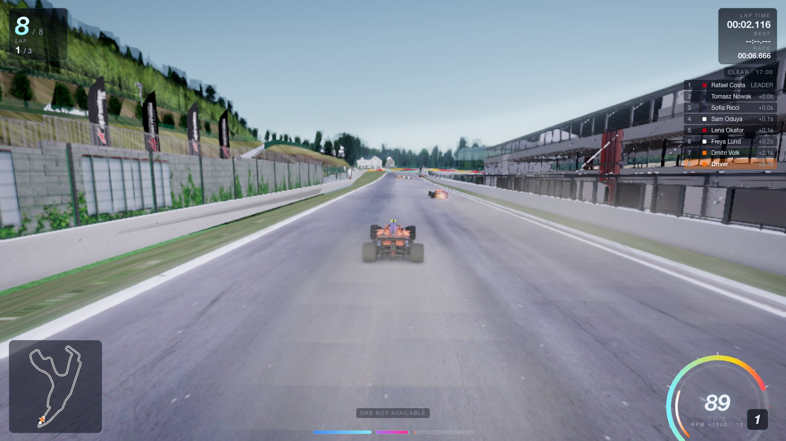
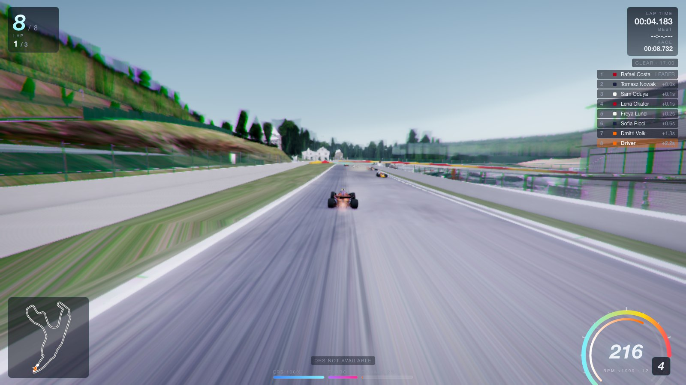
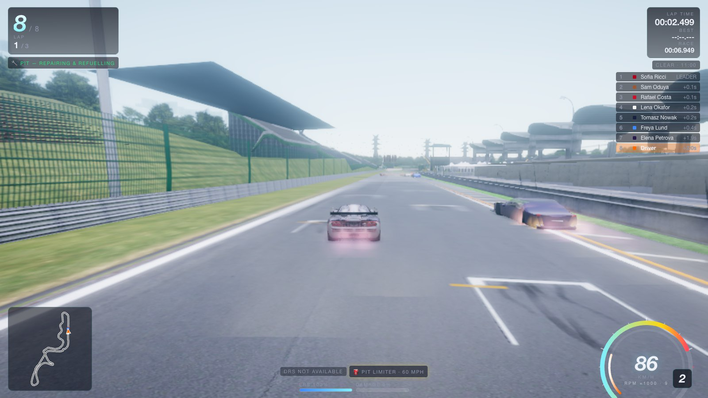
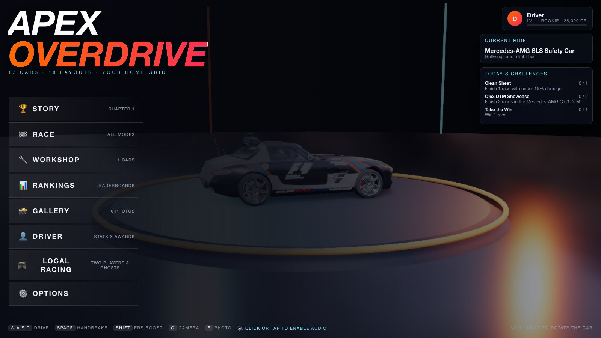

# Apex Overdrive

A browser-native 3D racing game with real-circuit models, a career, AI rivals, local two-player split screen, calibrated racing-wheel input, replays and your own photos on trackside billboards. React owns the menus and HUD; Three.js and Rapier own the driving experience. No account, install or backend is required.

It's for families and home sim-racers who want a proper racing game that runs in a browser tab: plug in a wheel or a controller, or use the keyboard or touch, and race. I started it in August 2026 with my son as the design lead and chief tester. "Feels like a real game" is the bar, and two players on two wheels is the reason it exists.

It ships 17 CC-BY licensed cars (F1, GT, DTM and road cars) and 8 real-circuit models (Spa, Suzuka, Hungaroring, Sepang, Shanghai, Marina Bay, Indianapolis, Bugatti), alongside procedurally built circuits. See [ROADMAP.md](docs/ROADMAP.md) and the open issues for what's next.



| Flat out at 216 km/h | Suzuka in a McLaren F1 GTR |
| --- | --- |
|  |  |




| | |
|---|---|
| Rendering | [Three.js](https://threejs.org) r170 — PBR materials, PMREM environment lighting, cascaded-style shadow focus, GTAO ambient occlusion, bloom, speed blur, SMAA/FXAA |
| Physics | [Rapier](https://rapier.rs) (WASM) rigid bodies + a custom raycast vehicle model (spring/damper suspension, magic-formula tyres, load transfer, aero, damage) |
| UI | React 19 + TypeScript, CSS animations, responsive down to phones, touch/tilt controls, gamepad |
| Audio | 100% procedural Web Audio: layered engine synthesis, turbo, skids, impacts, ambience, adaptive music, 3D positioning |
| Persistence | Versioned save profile in `localStorage` behind a `StorageAdapter` (cloud adapter scaffolded) |
| Tooling | Vite 7, ESLint, TypeScript strict mode |

## Play locally

On macOS, double-click `Start Apex.command`. It opens the built game at
http://127.0.0.1:4173. Keep its Terminal window open while playing. Choose
**Race → Open Driving → Sepang International Circuit - Fam Jam** for family
billboards, or choose **Two players** for split screen.

To build and play from a terminal:

```sh
npm ci
npm run build
npm start
```

For development, use `npm run dev`.

Requirements: Node 22.12+, a browser with WebGL 2 + WebAssembly (Chrome, Edge, Firefox, Safari 16+). See [docs/SETUP.md](docs/SETUP.md) for details and troubleshooting.

## Controls

| Action | Keyboard | Gamepad | Touch |
|---|---|---|---|
| Steer | A / D or ← / → | Left stick | ◀ ▶ buttons or tilt |
| Throttle / Brake | W / S or ↑ / ↓ | RT / LT | GAS / BRAKE |
| Handbrake | Space | B | E-BRK |
| ERS boost | Shift | Stick up / L3 | NOS |
| Gears (manual) | Q / E | LB / RB | — |
| Camera | C | Y | CAM |
| Look back | B | Stick down | — |
| Reset car | R | Select | RESET |
| Photo mode | F | — | — |
| Replay (after finish) | V | — | — |
| Hide HUD | N | — | — |
| Pause | Esc / P | Start | ❚❚ |

Wheel input targets consumer Logitech G29 / G920 / G923-class devices exposed by macOS Chrome (physical hardware compatibility has not yet been tested): calibrate and assign them to players in Options → Controls. Local two-player split screen (top/bottom or side by side) is in Race Setup → Players. **Sepang - Fam Jam** puts your own photos on trackside billboards: drop them in `assets-src/photos/fam-jam` and run `npm run assets:photos` (see docs/ASSET_PIPELINE.md); without photos the boards are blank. Full list in [docs/CONTROLS.md](docs/CONTROLS.md).

## Project layout

```
src/
  main.tsx, App.tsx          React shell, screen routing
  index.css                  design tokens + all UI styles
  game/
    content/    validated local content packs and registration
    core/       Engine (loop/orchestration), EventBus, Settings/quality, Store, Logger, math
    physics/    PhysicsWorld (Rapier), VehicleController (raycast car), TireModel, Surfaces
    vehicles/   VehicleSpec (data model, upgrades, customization), VehicleCatalog (licensed cars),
                CarMeshBuilder (procedural car bodies), Vehicle (entity)
    tracks/     TrackCatalog (circuits and variants), Spline, TrackBuilder, TrackProps, Hazards
    ai/         DriverProfiles (24 rivals, tiers), RacingLine (optimiser + speed profile), AIDriver
    render/     Sky/time-of-day, Weather, PostProcessing, CameraRig, Particles, TextureFactory,
                QualityManager (dynamic resolution), Showcase (menu studio)
    audio/      AudioEngine (mixer, 3D voices, SFX, ambience), EngineSynth, MusicSystem
    gameplay/   GameModes, RaceManager, Progression, Career, Achievements, Challenges,
                Leaderboards, DriftScoring, Replay/ghosts, PhotoMode
    input/      InputManager (keyboard, gamepad, touch, tilt)
    persistence/ StorageAdapter (local / memory / cloud scaffold), SaveManager (migrations)
    net/        NetworkProvider contracts + offline implementation (matchmaking, rooms,
                ratings, friends, voice, ghosts)
    state/      GameStore (UI-facing observable state)
  ui/
    screens/    Menu, Career, Garage, RaceSetup, Rankings, Gallery, Options, Stats, Results, Local racing
    hud/        HUD, Speedometer, Minimap, TouchControls, PauseMenu, ReplayControls, PhotoOverlay
    components/ Button, Controls, Screen, Toasts
docs/           architecture, setup, build, physics, performance, asset pipeline, roadmap
tools/asset-pipeline/  conversion, rigging, compression, photos, manifest and validation
public/assets/  compressed licensed models, HDRI and local family photos
```

## Documentation

- [Architecture](docs/ARCHITECTURE.md) — systems, data flow, frame loop, extension points
- [Physics & handling model](docs/PHYSICS.md) — tyre/suspension/aero math and tuning knobs
- [Setup](docs/SETUP.md) — local development, browser requirements, debugging hooks
- [Build & deploy](docs/BUILD.md) — production build, hosting, chunking
- [Performance](docs/PERFORMANCE.md) — quality tiers, budgets, profiling notes, mobile
- [Asset pipeline](docs/ASSET_PIPELINE.md) — licensed models, compression, procedural fallbacks and photos
- [Controls](docs/CONTROLS.md)
- [Wheel setup and two identical controllers](docs/CONTROLLERS.md)
- [Adding content and systems](docs/EXTENDING.md)
- [2.0 verification and known limits](docs/VERIFICATION.md)
- [Roadmap](docs/ROADMAP.md) — future additions incl. multiplayer

## Scripts

| Script | Purpose |
|---|---|
| `npm run dev` | Vite dev server with HMR (`--host` exposes it on the LAN for phone testing) |
| `npm run build` | Type-check + production bundle into `dist/` |
| `npm run preview` | Serve the production build locally |
| `npm run typecheck` | `tsc -b` only |
| `npm run lint` | ESLint |
| `npm test` | Starts an isolated server and runs all browser/module regressions |
| `npm run check` | Types, lint, build, regression suites and production smoke test |
| `npm start` | Open the built game at a stable local address |
| `npm run assets:manifest` | Regenerate `public/assets/manifest.json` from files on disk |
| `npm run assets:validate` | Validate asset sizes / formats against the budget |

## License

The source code is [MIT](LICENSE) © 2026 Bello Mohammed.

The 3D car, circuit and steering-wheel models are not covered by the MIT license. Each is CC-BY 4.0 from its author on Sketchfab, and the sky HDRI is CC0 from Poly Haven. Full credits are in [`public/assets/models/ATTRIBUTION.md`](public/assets/models/ATTRIBUTION.md); keep those notices if you share the project. Audio, liveries, crowds, signage and most textures are generated in code.

Car, team and circuit names are trademarks of their respective owners. This is an independent fan project, not affiliated with or endorsed by any of them. AI driver names are fictional.
